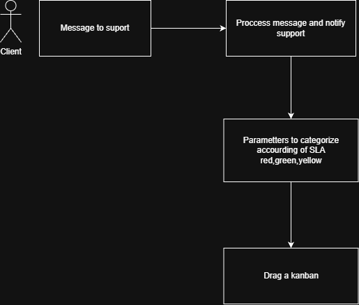

# Project zap-bridge

 Zap bridge is a open source project to connect whatsapp and categorize messages accourding the configuration.
 You config the limit time for label your operation response priority
 E.g - The message was send 10 minutes ago its OK for SLA (Service Level Agreement) soo if the message was delivered 20 minutes ago its a yellow flag to operation.

## Use Case

## Manifesto

- My girlfriend work in company who need get whatsapp messages of suport whatsapp and categorize it according limit time and FIFO (First in First out) service

## How to run

First create a **.env** file inner /packages/backend/api following the **.env.sample**

Execute in the root path

``docker compose --env-file packages/backend/api/.env up --build -d``

Then you can check this request must return ``{work: true}``

``curl http://localhost:3001/api/health``

## Backlog

 [ ] User Domain Scaffold

 [ ] Auth

 [ ] OAuth

 [ ] Configure WhatsApp provider

 [ ] Weebhook to listen whatsapp groups and private messages

 [ ] Categorize the message according configured criteria and notify support

 [ ] Drag a task to defined steps in kanban
