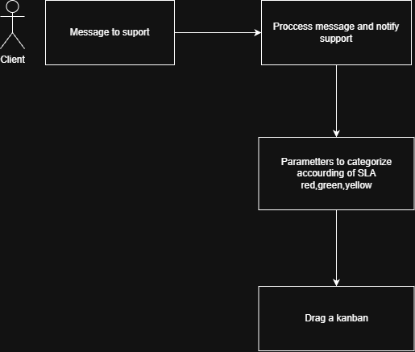

# Project zap-bridge

 Zap bridge is a open source project to connect whatsapp and categorize messages accourding the configuration.
 You config the limit time for label your operation response priority
 E.g - The message was send 10 minutes ago its OK for SLA (Service Level Agreement) soo if the message was delivered 20 minutes ago its a yellow flag to operation.

## Use Case

## Manifesto

- My girlfriend work in company who need get whatsapp messages of suport whatsapp and categorize it according limit time and FIFO (First in First out) service

## How to run

First of all you need install dependencies
``bun install``

How to run the project?
``bun dev``
